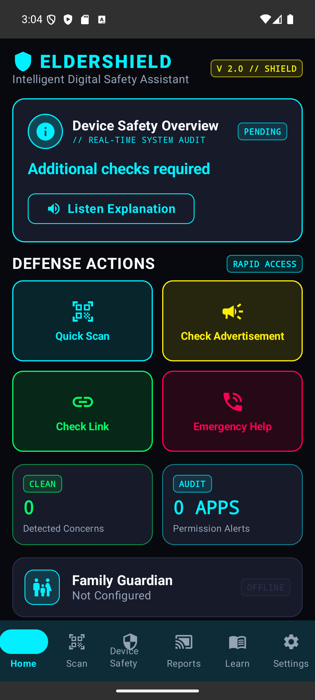
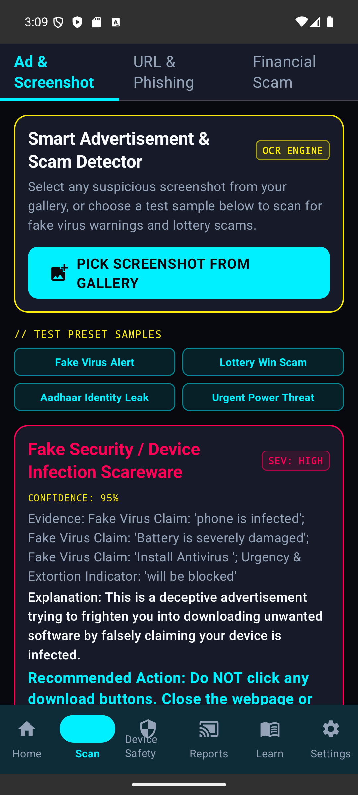

<p align="center">
  
</p>

<h1 align="center">ElderShield</h1>

<p align="center">
  <strong>Intelligent Personal Cybersecurity & Digital Safety Assistant for Android</strong><br>
  <em>Protecting elderly and non-technical smartphone users from digital fraud, scareware, and privacy leakage.</em>
</p>

<p align="center">
  
  
  
  
  
  
</p>

---

## 📖 About ElderShield

Elderly and non-technical smartphone users are disproportionately targeted by cyber threats: **deceptive advertisements**, **fake virus scareware**, **UPI payment fraud**, **phishing links**, **unauthorized remote-access tools**, and **identity leakage**. Most existing antivirus apps display cryptic technical metrics and arbitrary "percent-hacked" probabilities that confuse and terrify users.

**ElderShield** is a modern, privacy-first Android cybersecurity assistant designed from the ground up for non-technical users. It uses **explainable on-device AI**, transparent rule-based detection, **voice guidance**, and a **high-contrast cyber defense design** to clearly distinguish real threats from legitimate content—in both **English and Tamil (தமிழ்)**.

---

## 📱 App Showcase

<p align="center">
  
  &nbsp;&nbsp;&nbsp;&nbsp;
  
</p>

<p align="center">
  <em>Left: Live Cyber Dashboard with defense actions & safety audit. Right: ML Kit OCR scam analysis identifying fake virus scareware.</em>
</p>

---

## ✨ Key Features & Defense Modules

### 1. 🛡️ Smart Advertisement & Scareware Detector
* **Gallery & Photo Picker:** Import any suspicious screenshot from SMS, WhatsApp, or browsers.
* **On-Device Vision OCR:** Powered by Google ML Kit to extract text directly on the device with zero cloud uploads.
* **Hybrid Rule & AI Engine:** Detects fake virus claims (*"Your phone is infected!"*), fake lottery/gift awards, cleaner/booster scare tactics, and urgent extortion demands.
* **Transparent Findings:** Displays detected evidence, severity (`LOW`, `MEDIUM`, `HIGH`, `CRITICAL`), confidence score, plain-language explanation, and concrete safe actions.

### 2. 🔗 Suspicious URL & Phishing Inspector
* **Live Heuristic Scanning:** Analyzes domain names, raw IP-address hostnames (`http://192.168.1.1/login`), URL shorteners, and known malicious TLDs.
* **Typosquatting Detection:** Flags deceptive lookalike domains impersonating banks and government portals (e.g., `sbi-verify-kyc.xyz`).
* **Truth in HTTPS:** Clearly explains that having an SSL padlock does *not* automatically make a website safe.

### 3. 📱 Device Safety & Permission Auditor
* **Live Installed Application Audit:** Queries Android's `PackageManager` to identify all accessible third-party applications.
* **Sensitive Permission Flagging:** Categorizes apps with access to **Camera**, **Microphone**, **Location**, **Contacts**, and **SMS**.
* **Remote Access Tool Alert:** Automatically flags installed remote desktop utilities (e.g., AnyDesk, TeamViewer) that scammers often trick elders into downloading.
* **Sideload Detection:** Distinguishes apps installed from official app stores versus untrusted APK sources.
* **1-Tap Android Settings:** Direct access to system settings to revoke unnecessary permissions.

### 4. 💳 Financial & UPI Scam Guard
* **Reverse-Charge Scam Warning:** Warns users of the #1 UPI scam in India: *"Entering your UPI PIN always sends money; you NEVER enter a PIN to receive refunds."*
* **QR Code Traps:** Identifies fraudulent collect-request payment scams.
* **Emergency Helpline:** Integrated direct shortcut to report financial cybercrime via the National Cybercrime Portal (`1930`).

### 5. 🗣️ Bilingual Voice Guidance & Accessibility
* **Spoken Explanations:** Integrated Android `TextToSpeech` reads scan findings and risk explanations aloud in simple language.
* **Full Tamil & English Localization:** Complete runtime locale toggle between **தமிழ்** and **English**.
* **Large Text Mode:** Custom scalable typography designed for elderly eyesight.

### 6. 📚 Interactive Cyber Safety Academy
* **Educational Modules:** Lessons on Fake Callers, UPI Protection, Password Hygiene, and Identity Safeguards.
* **Knowledge Check Quizzes:** Interactive multiple-choice quizzes with real-time scoring to reinforce safe habits.

---

## 🎨 High-Contrast Cyber Design System

ElderShield adopts a custom **high-contrast cyber security aesthetic** that pairs a sleek modern look with maximum visual accessibility:

| Color Token | Hex Code | Visual Meaning |
| :--- | :--- | :--- |
| **Cyber Void Black** | `#08090E` | Deep background minimizing glare and battery drain |
| **Neon Cyan** | `#00F0FF` | Primary actions, scanning radars, and brand glow |
| **Electric Yellow** | `#FCEE0A` | Warnings, caution indicators, and attention alerts |
| **Laser Pink / Red** | `#FF0055` | Critical threats, emergency actions, and scam warnings |
| **Matrix Green** | `#00FF66` | Clean status, safe indicators, and verified states |

* All touch targets are sized **≥ 56dp** for easy tapping by tremors or older fingers.
* High contrast ratio meets **WCAG AAA** guidelines on AMOLED screens.

---

## 🏗️ Architecture & Tech Stack

The project adheres to **Clean Architecture** principles and the modern **Android Architecture Recommendations**:

```
ElderShield/
├── app/src/main/java/com/eldershield/
│   ├── core/
│   │   ├── database/       # Room Database, Converters & DatabaseModule
│   │   ├── localization/   # Runtime LocaleHelper (English & Tamil)
│   │   ├── preferences/    # Jetpack DataStore UserPreferences
│   │   ├── ui/             # Cyberpunk Theme, Color Palette & Custom Components
│   │   └── voice/          # Android TextToSpeech VoiceAssistant
│   ├── data/
│   │   ├── dao/            # Room DAOs (ThreatDao, ScanDao, AppSecurityDao, etc.)
│   │   └── entities/       # 11 Room Entities (Threats, Scans, Permissions, Contacts)
│   ├── domain/
│   │   ├── engines/        # ScamTextEngine, UrlRiskEngine, FinancialScamEngine, DeviceSecurityEngine
│   │   └── models/         # Domain Models (SecurityStatus, SeverityLevel, ThreatCategory)
│   ├── feature/
│   │   ├── dashboard/      # Cyberpunk Dashboard & Defense Actions
│   │   ├── scamdetector/   # Scan Hub, OCR Vision & Analysis Cards
│   │   ├── permissionaudit/# App Audit & Dangerous Permission Inspector
│   │   ├── reports/        # Security Log, Incident History & Threat Reports
│   │   ├── learning/       # Interactive Lessons & Safety Quiz
│   │   └── settings/       # Language, Accessibility & Family Guardian
│   └── navigation/         # Compose Navigation Graph & Cyber Bottom Bar
```

### Libraries & Tools:
* **UI:** Jetpack Compose (BOM `2024.01.00`), Material 3, Navigation Compose
* **Dependency Injection:** Dagger Hilt `2.50`
* **Local Storage:** Room `2.6.1` SQLite DB, DataStore Preferences
* **Concurrency:** Kotlin Coroutines & Reactive StateFlow
* **ML / Vision:** Google ML Kit Text Recognition (`play-services-mlkit-text-recognition:19.0.0`)
* **Build System:** Gradle 9.2.1, AGP 8.13.2, Kotlin 1.9.22, KSP

---

## 🔒 Privacy & Ethical AI Principles

1. **100% On-Device Processing:** ML Kit OCR and rule heuristics run locally on the phone. Images are never uploaded to any remote server.
2. **Zero Keystroke / Password Monitoring:** ElderShield never requests Accessibility Services for surveillance, never reads OTPs, and never records banking credentials.
3. **No Fake Threat Scores:** We never manufacture alarming numbers (e.g. *"Your phone is 89% infected!"*). Assessments are strictly factual and explainable.
4. **Explicit Consent:** Family emergency alerts and usage statistics require explicit opt-in consent from the user.

---

## 🛠️ How to Build & Run

### Prerequisites
* **Android Studio:** Ladybug (2024.2.1+) or newer
* **JDK:** Java 17 or Java 21 (Bundled Android Studio JBR)
* **Android SDK:** Platform 34 (Android 14) and Build-Tools 34.0.0+

### Clone & Build
```powershell
# 1. Clone the repository
git clone https://github.com/gayuze/ElderShield.git
cd ElderShield

# 2. Build the Debug APK
.\gradlew assembleDebug

# 3. Run Unit Tests
.\gradlew test
```

The compiled APK will be generated at:
```text
app/build/outputs/apk/debug/app-debug.apk
```

---

## 👩‍💻 Author & Contributions

* **Developer:** [gayuze](https://github.com/gayuze)
* **Project:** ElderShield – Intelligent Personal Cybersecurity and Digital Safety Assistant
* **License:** [MIT License](LICENSE)

Contributions, feature requests, and security feedback are welcome! Feel free to star ⭐ the repository if you found this project helpful!
